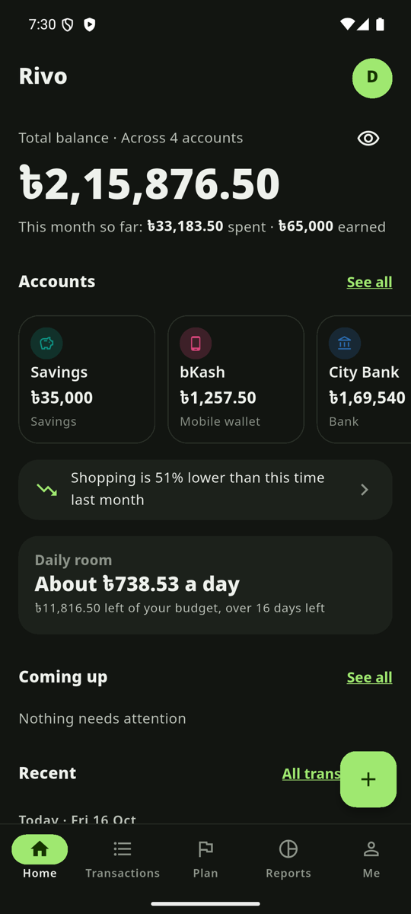
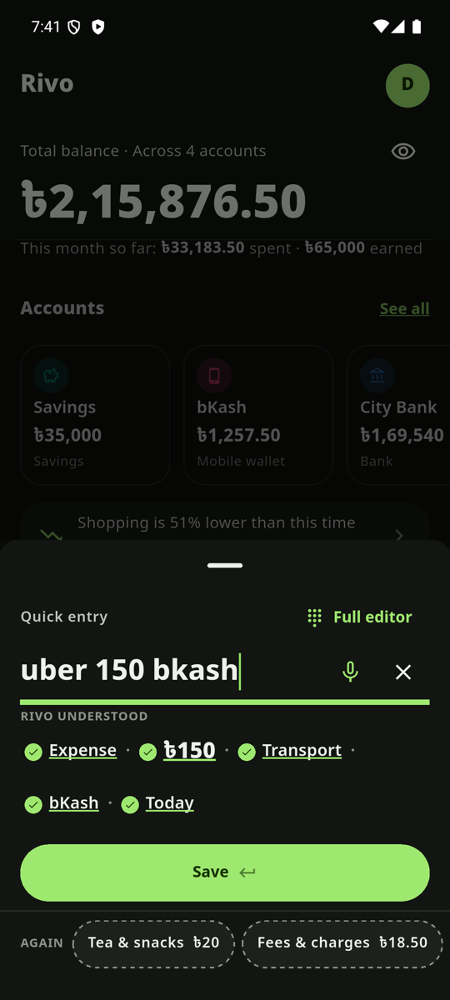
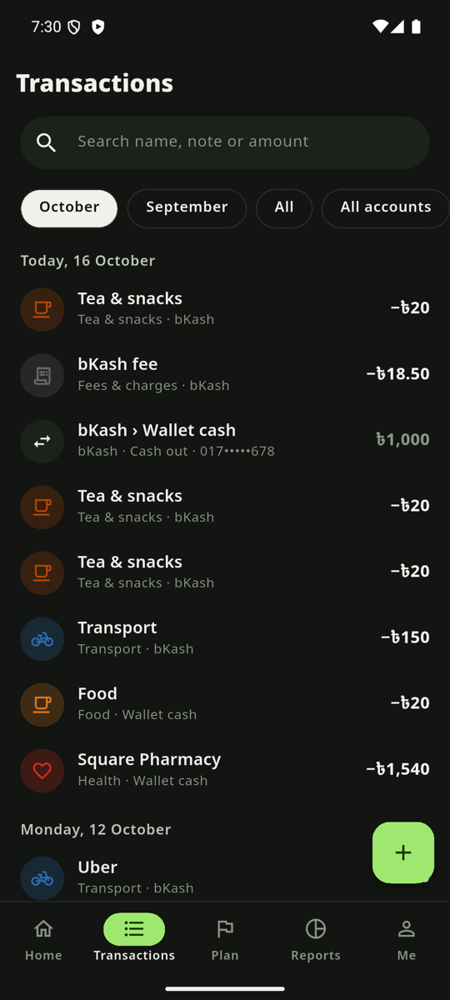
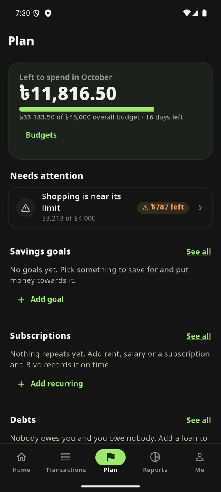
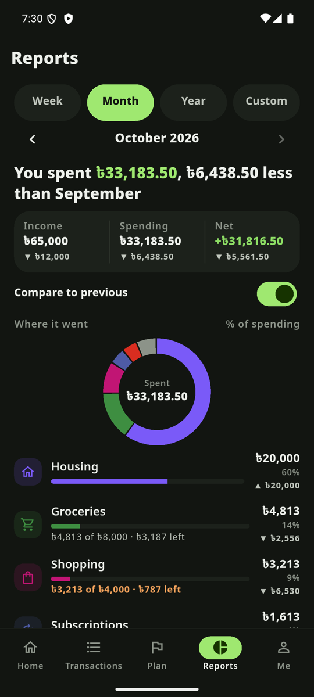

<p align="center">
  
</p>

<h1 align="center">Rivo</h1>
<p align="center"><b>Know where your money goes.</b><br/>Cash, bank and bKash in one calm place. English first, full বাংলা.</p>

<p align="center">
  <a href="https://github.com/mdmakky/rivo-android/releases/latest/download/rivo-arm64-v8a.apk"></a>
</p>
<p align="center">
  <a href="https://github.com/mdmakky/rivo-android/releases/latest"></a>
  
  
  <a href="https://rivo-navy.vercel.app"></a>
</p>

<p align="center">
  
  
  
  
  
</p>

## What it does

- **Type it, say it, or share the SMS.** Write `tea 20`, `uber 150 bkash` or `চা ২০` and Rivo shows what it understood. Share a bKash, Nagad or bank SMS to Rivo and it becomes an entry, with the fee split out and the number masked. The same message is never added twice. Rivo has **no SMS permission**: it only sees a message you choose to share.
- **All your money, one picture.** Cash, bank, mobile wallets and savings, with a soft warning before an account goes below zero.
- **Plan.** Monthly budgets (overall and per category), savings goals, recurring entries, money lent and borrowed.
- **Reports** by month or any date range, plus CSV import and export.
- **Works offline.** Everything works with no internet and syncs when you are back online.
- **Private.** App lock with fingerprint, hide balance, dark and light themes. Every number comes from the database, never from the app's own guesswork.
- **Home-screen widgets**, long-press shortcuts and a Quick Settings tile for one-tap entry by typing or voice.

Coming soon: net worth view.

## Install

1. On your phone, open the [latest release](https://github.com/mdmakky/rivo-android/releases/latest).
2. Download **`rivo-arm64-v8a.apk`** (right for almost every modern phone). Very old phones: `rivo-armeabi-v7a.apk`.
3. Open the file. Android will ask you to allow installs from your browser or file manager: allow it once. Then tap **Install**.

Updating: download the newer APK and install it over the old one. Your data stays in your account.

## Verify the download

Every release lists `SHA256SUMS.txt`. The APKs are signed with the Rivo release key:

```
SHA-256  cd:4c:23:20:08:b3:a9:08:ea:27:09:0c:4e:78:c1:ff:ff:93:4d:93:09:8c:c0:e8:7d:89:d6:2a:ef:3b:4b:99
SHA-1    8b:db:e1:49:79:4b:ce:78:f0:95:0c:a0:b8:6c:32:77:53:c8:54:3f
```

Check with `apksigner verify --print-certs rivo-arm64-v8a.apk` or `shasum -a 256 -c SHA256SUMS.txt`.

## Your data

[Privacy](https://rivo-navy.vercel.app/privacy) · [Terms](https://rivo-navy.vercel.app/terms) · [Delete your account](https://rivo-navy.vercel.app/delete-account)

You can delete your account and everything in it from the app (Me, then Delete account).

## Feedback

Found a bug or have an idea? [Open an issue](https://github.com/mdmakky/rivo-android/issues) or write to makky.cse@gmail.com. Please never post your real balances or personal SMS text in an issue.

---

<sub>Rivo is early-access software, free to use while in early access. This repository holds the downloads and release notes; the source code is not public. © Md. Arafatuzzaman. All rights reserved.</sub>
